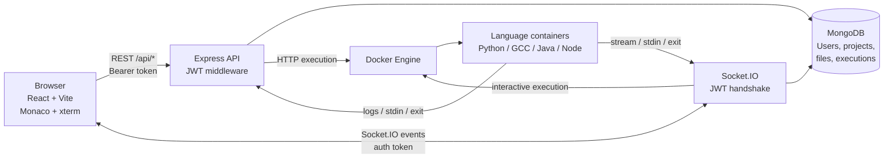
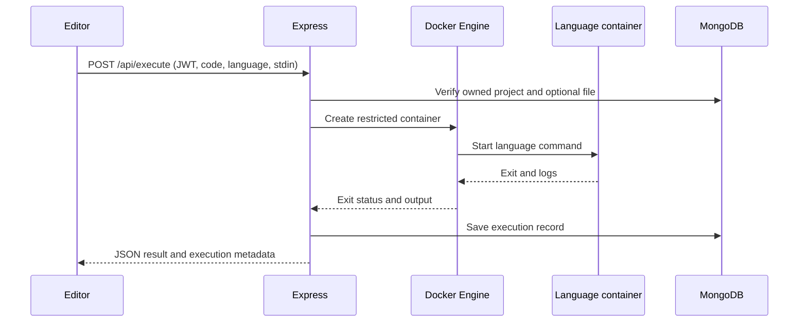

# CloudCode-IDE

**A browser-based coding workspace with saved projects and Docker-backed code execution.**

[](https://react.dev/)
[](https://vite.dev/)
[](https://nodejs.org/)
[](https://www.docker.com/)

> **Status:** Active codebase, but not a verified production deployment. Some visible UI is illustrative or not connected to backend functionality; see [Current status and limitations](#current-status-and-limitations).

## Table of contents

- [Introduction](#introduction)
- [Objectives](#objectives)
- [Problem statement](#problem-statement)
- [Features](#features)
- [Supported languages](#supported-languages)
- [Technology stack](#technology-stack)
- [Architecture](#architecture)
- [Project structure](#project-structure)
- [Frontend and backend responsibilities](#frontend-and-backend-responsibilities)
- [Authentication workflow](#authentication-workflow)
- [Project and file management workflow](#project-and-file-management-workflow)
- [Docker code execution workflow](#docker-code-execution-workflow)
- [Interactive terminal and Socket.IO workflow](#interactive-terminal-and-socketio-workflow)
- [MongoDB persistence](#mongodb-persistence)
- [Storage quota](#storage-quota)
- [Docker security restrictions](#docker-security-restrictions)
- [API overview](#api-overview)
- [Prerequisites](#prerequisites)
- [Installation](#installation)
- [Environment configuration](#environment-configuration)
- [Run the frontend](#run-the-frontend)
- [Run the backend](#run-the-backend)
- [Docker image setup](#docker-image-setup)
- [Production architecture](#production-architecture)
- [Deployment guidance](#deployment-guidance)
- [Testing and quality checks](#testing-and-quality-checks)
- [Security considerations](#security-considerations)
- [Current status and limitations](#current-status-and-limitations)
- [Future enhancements](#future-enhancements)
- [Author and license](#author-and-license)

## Introduction

CloudCode-IDE is a web application for creating projects, editing source files in the browser, saving those files to MongoDB, and running code in Docker containers managed by the backend. The frontend is a React single-page application built with Vite. Its Express API also provides JWT authentication, project/file management, storage usage, and saved execution history.

The codebase includes both request/response execution and a Socket.IO-based interactive run path. These are distinct server-side execution services and should not be assumed to have identical runtime behavior.

## Objectives

- Provide a browser interface for editing code without installing language toolchains on the client.
- Persist user accounts, projects, files, and execution records in MongoDB.
- Run submitted code in language-specific Docker images.
- Support an interactive input/output session over Socket.IO.
- Limit per-user stored file content and place resource restrictions on execution containers.

## Problem statement

Local development environments require users to install and configure compilers and runtimes. CloudCode aims to centralize a basic editing and execution workflow behind a web interface. The current implementation is a foundation rather than a complete hosted IDE: deployment, collaboration, and several account/editor settings are not implemented or verified.

## Features

Implemented in the current source:

- Account registration, login, and current-user lookup using JWT bearer tokens.
- Project creation and listing.
- Per-project file listing and file create, update, and delete operations.
- Browser code editing with Monaco Editor.
- HTTP execution with standard input and interactive execution using Socket.IO.
- Saved execution history and a history view.
- A 50 MiB per-user quota on persisted file content.
- Dashboard storage usage and recent execution summaries.
- A browser terminal rendered with xterm.js.

Visible but incomplete or constrained:

- The home-page Run demo displays hard-coded sample output after a timer; it does not call the execution API.
- Editor folders exist only in the current browser session and are not represented in the backend data model.
- Profile editing, password change, editor preference persistence, search, source control, and extension UI are not connected to backend implementations.
- The editor Share action copies the current URL; it does not create access permissions or a share token.

## Supported languages

Both backend execution services currently configure these languages:

| Language | Accepted identifiers | Runtime / image |
|---|---|---|
| Python | `python` | `python:3.12-slim` |
| C | `c` | `gcc:14` |
| C++ | `cpp`, `c++` | `gcc:14` |
| Java | `java` | `eclipse-temurin:21-jdk` |
| JavaScript | `javascript`, `js` | `node:22-alpine` |

The editor supplies starter files and Monaco language modes for the same five languages. Project language values are not enforced against this list by the project route; execution rejects unsupported identifiers.

## Technology stack

| Area | Technologies |
|---|---|
| Frontend | React 19, React Router 7, Vite 8 |
| Code editor | `@monaco-editor/react` |
| Terminal | `@xterm/xterm`, `@xterm/addon-fit` |
| Realtime client/server | `socket.io-client`, Socket.IO |
| Backend | Node.js, Express 5 |
| Persistence | MongoDB through Mongoose 9 |
| Authentication | JSON Web Tokens (`jsonwebtoken`), `bcryptjs` |
| Code execution | Docker Engine through Dockerode |
| Configuration | `dotenv` |

The lockfiles use npm lockfile version 3. Use a Node.js release supported by the installed Vite 8 package and Docker Engine compatible with the runtime images.

## Architecture



In the current development setup, Vite proxies REST requests under `/api` to `http://localhost:5000`. The editor's Socket.IO client separately connects to `http://localhost:5000`; the server's Socket.IO CORS origin is fixed to `http://localhost:5173`.

## Project structure

The following is the application source tree; dependency directories such as `node_modules` are intentionally omitted.

```text
CCBDI_PROJECT/
├── .gitignore
├── README.md
├── backend/
│   ├── .env                         # Local secret-bearing file; do not commit
│   ├── README.md
│   ├── package.json
│   ├── package-lock.json
│   ├── server.js
│   ├── middleware/
│   │   ├── authMiddleware.js
│   │   └── socketAuthMiddleware.js
│   ├── models/
│   │   ├── Execution.js
│   │   ├── File.js
│   │   ├── Project.js
│   │   └── User.js
│   ├── routes/
│   │   ├── authRoutes.js
│   │   ├── executionRoutes.js
│   │   ├── fileRoutes.js
│   │   ├── historyRoutes.js
│   │   └── projectRoutes.js
│   └── services/
│       ├── executionService.js
│       └── interactiveExecutionService.js
└── frontend/
    ├── README.md
    ├── index.html
    ├── package.json
    ├── package-lock.json
    ├── vite.config.js
    ├── eslint.config.js
    ├── public/
    │   ├── favicon.svg
    │   └── icons.svg
    └── src/
        ├── App.jsx
        ├── App.css
        ├── index.css
        ├── assets/
        │   ├── hero.png
        │   ├── react.svg
        │   └── vite.svg
        ├── components/
        │   ├── auth/PasswordField.jsx
        │   ├── common/Icon.jsx
        │   ├── common/Logo.jsx
        │   └── editor/
        │       ├── BottomPanel.jsx
        │       ├── FileExplorer.jsx
        │       └── Toolbar.jsx
        ├── Data/
        │   ├── dashboardData.js
        │   ├── editorData.js
        │   ├── historyData.js
        │   ├── LoginData.js
        │   ├── projectsData.js
        │   ├── registerData.js
        │   └── settingsData.js
        ├── pages/
        │   ├── Dashboard.css
        │   ├── Dashboard.jsx
        │   ├── Editor.css
        │   ├── Editor.jsx
        │   ├── History.css
        │   ├── History.jsx
        │   ├── home.css
        │   ├── Home.jsx
        │   ├── login.css
        │   ├── Login.jsx
        │   ├── Projects.css
        │   ├── Projects.jsx
        │   ├── Register.css
        │   ├── Register.jsx
        │   ├── Settings.css
        │   └── Settings.jsx
        └── services/storageService.js
```

## Frontend and backend responsibilities

- **Frontend:** renders routes and views, stores the signed-in token in browser storage, calls the REST API, sends and receives execution events, and displays code/output.
- **Backend:** verifies JWTs, enforces ownership checks, reads/writes MongoDB records, tracks file-content quota, creates and cleans up Docker containers, and records execution history.
- **MongoDB:** stores user, project, file, and execution documents. Files are stored as document content rather than written to a shared host filesystem by the application.
- **Docker Engine:** runs the submitted source in the configured language image. The backend requires access to the Docker daemon.

## Authentication workflow

1. The frontend submits `name`, `email`, and `password` to `POST /api/auth/register`, or `email` and `password` to `POST /api/auth/login`.
2. The backend hashes registration passwords with `bcryptjs` and verifies the hash at login.
3. Login issues a JWT containing `userId`, with a seven-day expiry.
4. The frontend stores the token and user summary in `localStorage` when “Remember me” is selected, or `sessionStorage` otherwise.
5. REST clients send `Authorization: Bearer <token>`. Socket.IO sends the token in handshake `auth`.
6. API and socket middleware verify the JWT using `JWT_SECRET`; protected handlers use its `userId` to scope data access.

The frontend clears stored login state when it receives an unauthorized response in the implemented flows. Tokens in browser storage are accessible to JavaScript on the page, so production deployments require strong XSS prevention and a reviewed token-storage policy.

## Project and file management workflow

Projects belong to a user. Files reference both a project and an owner. The editor loads the user's projects and files through authenticated APIs and creates a starter file if the selected project is empty. Saving, renaming, or changing the language updates the file document. Deleting a file also releases its content bytes from the quota counter.

The frontend does not persist project folders. Project deletion and project update endpoints are not present in the backend.

## Docker code execution workflow



The HTTP route accepts a source string, a language, optional `stdin`, and a required project ID; an optional file ID must belong to that project and user. This path has a 10-second timeout. It executes one complete process and returns collected logs and a result object.

## Interactive terminal and Socket.IO workflow

The editor authenticates the Socket.IO connection using the same JWT as REST. It emits `execution:start` with code, language, project and file IDs, and display metadata. The server creates a container with stdin attached, streams output, accepts `execution:input`, and terminates on `execution:stop`. The `execution:exit` event carries completion metadata. Completed interactive runs are recorded in history after ownership checks.

Interactive service limits include five minutes per run, two active sessions per user in this server process, and a 10,000-character limit for each input payload. It captures up to 1 MiB of program output for completion/history and adds a truncation notice when a chunk crosses that limit; live chunks continue to be forwarded. These limits do not turn the service into a multi-host session coordinator; its active session map is in process memory.

## MongoDB persistence

The Mongoose models are:

- `User`: name, unique normalized email, password hash, storage counter, timestamps.
- `Project`: name, description, language, owner reference, timestamps.
- `File`: name, content, language, project and owner references, timestamps.
- `Execution`: owner/project/file references, project/file names, language, source, input, output, error, status, duration, optional memory value, execution type, timestamps.

The backend connects to the configured MongoDB URI before it starts listening. File mutations use MongoDB transactions. The target database must support transactions; MongoDB Atlas deployments do, while a standalone local `mongod` generally needs replica-set configuration before these routes can complete their transaction blocks.

## Storage quota

The file API enforces a **50 MiB (52,428,800 byte)** per-user quota on UTF-8 encoded file content. It atomically reserves or releases bytes in `User.storageUsedBytes` during file mutations. Older users without an initialized counter are migrated by summing their stored file contents on first quota access. Project names, execution history, and other metadata are not counted as file-content bytes.

The frontend reads usage from `GET /api/files/storage/usage` and displays it on the dashboard. Quota errors use HTTP `413` and include the storage information and required byte count.

## Docker security restrictions

Both execution services configure containers with:

- `NetworkMode: "none"` (no container network access).
- 128 MiB memory and 128 MiB total memory-plus-swap limit (`MemorySwap` equals `Memory`, so no additional swap is allowed).
- 0.5 CPU (`NanoCpus: 500000000`) and a PID limit of 64.
- All Linux capabilities dropped and `no-new-privileges:true`.
- A read-only root filesystem.
- Size-limited writable tmpfs mounts at `/tmp` and `/workspace`.
- Forced container removal is attempted during cleanup.

The HTTP service enforces a 10-second timeout; the interactive service uses a five-minute timeout. These settings are useful defense-in-depth, not a guarantee of safe execution. The codebase does not configure a custom seccomp profile, non-root container user, daemon isolation, request rate limiting, or a distributed execution queue. Operators must treat Docker daemon access and arbitrary code execution as high risk.

## API overview

Protected routes require `Authorization: Bearer <JWT>` except where marked public. See [backend/README.md](./backend/README.md) for bodies and response shapes.

| Method | Path | Auth | Purpose |
|---|---|---:|---|
| `POST` | `/api/auth/register` | No | Register an account |
| `POST` | `/api/auth/login` | No | Authenticate and issue a JWT |
| `GET` | `/api/auth/me` | Yes | Get the current user |
| `GET` | `/api/projects/test` | No | Project-router test response |
| `GET` | `/api/projects` | Yes | List owned projects |
| `POST` | `/api/projects` | Yes | Create a project |
| `GET` | `/api/files/storage/usage` | Yes | Read storage usage |
| `POST` | `/api/files` | Yes | Create a file |
| `GET` | `/api/files/project/:projectId` | Yes | List project files |
| `PUT` | `/api/files/:fileId` | Yes | Update file name/content/language |
| `DELETE` | `/api/files/:fileId` | Yes | Delete a file |
| `POST` | `/api/execute` | Yes | Execute code over HTTP |
| `GET` | `/api/history` | Yes | Read up to 500 recent executions |
| `GET` | `/api/health` | No | Backend health message and database connection state |

Interactive execution is carried over Socket.IO, not a REST endpoint. The health endpoint reports connection state; it is not an external deployment monitor or a comprehensive readiness check.

## Prerequisites

- Node.js `^20.19.0` or `>=22.12.0` and npm, as required by the locked Vite 8 release.
- Docker Engine available to the backend process (Docker Desktop can provide the daemon on Windows/macOS).
- MongoDB connection string for a transaction-capable MongoDB deployment, such as Atlas.
- Git to clone the repository.

## Installation

From the repository root, install each package set separately:

```sh
cd backend
npm ci
cd ../frontend
npm ci
```

There is no root-level npm workspace or root start script.

## Environment configuration

Create `backend/.env` for local development. The backend reads these application variables:

| Variable | Required | Behavior |
|---|---:|---|
| `PORT` | No | HTTP/Socket.IO port; defaults to `5000` |
| `MONGO_URI` | Yes | MongoDB connection URI; startup exits if missing or connection fails |
| `JWT_SECRET` | Yes | Secret used to sign and verify JWTs |

Safe template (replace placeholders locally; never commit populated values):

```dotenv
PORT=5000
MONGO_URI=<your-transaction-capable-MongoDB-URI>
JWT_SECRET=<generate-a-long-random-secret>
```

No `VITE_*` setting is read by the frontend. Its development REST proxy and Socket.IO endpoint are currently configured in source, not environment configuration. A production setup should replace those localhost assumptions through reviewed configuration before deployment.

If maintaining a frontend example file, keep it comment-only until the app actually reads configurable values:

```dotenv
# No frontend environment variables are currently read by this application.
```

## Run the frontend

Start the backend separately first, then run:

```sh
cd frontend
npm run dev
```

Vite's configured development server uses its default address (normally `http://localhost:5173`). REST calls under `/api` are proxied to `http://localhost:5000`.

## Run the backend

With the required values in `backend/.env` and Docker Engine available:

```sh
cd backend
npm run dev
```

`npm run dev` starts `nodemon server.js`. For a non-watching local process:

```sh
npm start
```

The server connects to MongoDB before listening. `PORT` defaults to `5000`. The frontend Socket.IO client and server CORS settings assume the local ports described above.

## Docker image setup

The backend does not include Dockerfiles or an image build script. Pull each configured runtime image before first execution (Docker may also attempt to obtain a missing image when creating a container):

```sh
docker pull python:3.12-slim
docker pull gcc:14
docker pull eclipse-temurin:21-jdk
docker pull node:22-alpine
```

The backend process must be able to access the Docker daemon. Container images are substantial; ensure the host has enough disk and memory. The application does not currently pin images by digest or manage image updates.

## Production architecture

**Recommended target, not a verified or configured deployment:** serve the built frontend from a static host or web server; route `/api` and Socket.IO traffic to a Node.js backend; run that backend on a host with carefully restricted Docker daemon access; use MongoDB Atlas or another supported transaction-capable cluster; and terminate TLS at a trusted ingress.

No Oracle Cloud-specific deployment plan or configuration is present in this repository. The architecture above is a generic recommendation, not an OCI design, and no Oracle Cloud deployment has been verified. Add an approved Oracle Cloud topology only after its services and network design are supplied.

The current checkout is not production-ready as-is. The Vite proxy only applies during development, the socket client and Socket.IO CORS origin use localhost, and REST CORS is permissive. No production container, reverse proxy, CI/CD pipeline, hosting configuration, or deployment verification is present.

## Deployment guidance

No completed deployment can be documented from this repository. Before a production release:

1. Resolve the case-sensitive import paths noted below so the frontend can build on Linux.
2. Add configurable frontend API/socket endpoints and configure matching API and Socket.IO origins.
3. Set production secrets through the platform's secret manager; do not place secrets in frontend build variables.
4. Provide a transaction-capable MongoDB deployment and production database credentials.
5. Isolate the execution host and Docker daemon; assess whether a stronger sandbox boundary is required.
6. Build the frontend with `npm run build` and serve `frontend/dist` behind HTTPS.
7. Deploy the backend with `npm start`, expose only the required API/socket ports, and validate health, authentication, file transactions, quota enforcement, each runtime image, cleanup, and timeouts in a non-production environment.

These are recommendations, not instructions for an already-supported deployment target.

## Testing and quality checks

The frontend defines these checks:

```sh
cd frontend
npm run lint
npm run build
```

The backend `package.json` does not define a test or lint script. No automated test suite is present in the inspected source tree. No test result is implied by these instructions. End-to-end verification requires a configured MongoDB deployment and Docker daemon.

In this documentation pass, `npm run build` completed successfully (Vite emitted a large-chunk advisory). `npm run lint` exited with one existing `no-unused-vars` error for `saving` in `frontend/src/pages/Editor.jsx` and two React Hook dependency warnings in `BottomPanel.jsx` and `Editor.jsx`. No application source was changed to address those diagnostics.

## Security considerations

- Do not commit `backend/.env`, JWT secrets, MongoDB credentials, or populated environment files. `.gitignore` excludes `.env` and `.env.*` while allowing `.env.example`.
- Use a unique, high-entropy `JWT_SECRET`; rotate it if exposed. The code does not provide key rotation or token revocation.
- Treat user code and output as untrusted. Keep Docker isolated, patched, resource-limited, and inaccessible to untrusted users beyond the application.
- The REST API currently uses broad `cors()` configuration, while Socket.IO allows a fixed local origin. Configure production origins explicitly before exposure.
- Browser token storage is accessible to same-origin JavaScript. Apply appropriate XSS controls and review whether a secure cookie-based model is preferable.
- Validate and rate-limit authentication and execution at a production ingress. Rate limiting and abuse controls are not implemented in the inspected backend.
- Do not expose Docker daemon access to the public internet.

## Current status and limitations

Implemented features are listed in [Features](#features). Repository inspection also found:

- There are no test scripts, Dockerfiles, Compose configuration, CI workflows, production reverse-proxy files, or deployment manifests.
- Some imports use `data`/`Home.css`/`Login.css` casing that does not match the actual `Data`/`home.css`/`login.css` names. Windows resolves these names case-insensitively; a case-sensitive Linux filesystem may not. Verify and correct casing before Linux builds.
- HTTP REST routes are under `/api`; the Vite config proxies them locally. Socket.IO is hard-coded separately to localhost in the editor.
- Profile/password update and preference persistence callbacks are not wired to API routes. “Auto save” is presented as a setting but does not automatically save file edits.
- The home-page editor animation uses sample content and simulated output. It is not evidence that a code run succeeded.
- There is no root-level `LICENSE` file. The backend package's `ISC` metadata is not a project-wide license grant.

## Future enhancements

Potential follow-up work, not currently implemented:

- Add focused backend and frontend tests plus CI checks.
- Add environment-based frontend/backend origin configuration and production deployment manifests.
- Implement profile/password endpoints, persisted editor preferences, and meaningful auto-save.
- Persist folder hierarchy and add project update/delete operations.
- Add authentication rate limits, execution abuse controls, and robust output handling.
- Improve sandbox isolation, image pinning, observability, and multi-instance execution coordination.

## Author and license

The GitHub repository is [venkatsubash/CloudCode-IDE](https://github.com/venkatsubash/CloudCode-IDE). A project author credit beyond the repository owner has not been specified in the repository documentation. No root-level license file was found; choose and add an explicit project license before distributing the code. The backend package's `ISC` metadata alone does not establish a license for the entire repository.
