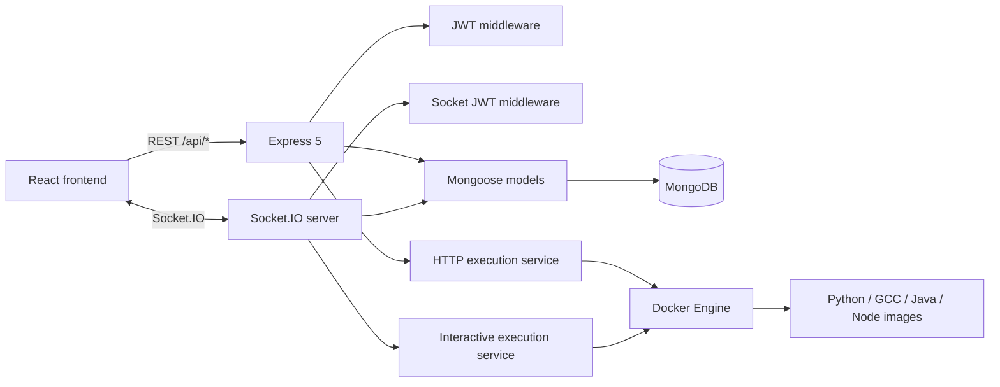

# CloudCode Backend

Express and Socket.IO server for CloudCode-IDE. It authenticates users, persists projects/files/executions in MongoDB, applies a file-content storage quota, and executes code in Docker containers.

## Architecture



`server.js` loads dotenv configuration, creates the Express and HTTP servers, installs Socket.IO, mounts the API routers, connects to MongoDB, and only then starts listening. HTTP requests and Socket.IO connections use separate JWT middleware. Execution services create containers through Dockerode.

## Node.js and Express configuration

The backend is CommonJS and runs `server.js`. The server applies JSON body parsing with a 2 MiB limit, Express CORS middleware, route mounting, and a JSON 404 response. A `/api/health` endpoint reports server status and whether Mongoose currently reports a connected database.

The REST CORS middleware uses the default `cors()` configuration. Socket.IO separately permits the fixed origin `http://localhost:5173` and methods `GET` and `POST`. These settings are development assumptions, not production origin configuration.

The server sets DNS resolvers to `8.8.8.8` at startup. The listening port comes from `PORT`, defaulting to `5000`.

## MongoDB Atlas integration

Mongoose connects to `MONGO_URI` before the HTTP server begins listening, with a 10-second server-selection timeout. Missing URI or connection failure causes startup to log an error and exit. The connection string is not documented here; provide it only through a local secret-bearing environment file or a deployment secret manager.

File create, update, and delete operations use MongoDB transactions to coordinate file content and the user's storage counter. Use a MongoDB deployment that supports transactions, such as a properly configured MongoDB Atlas cluster. A standalone local MongoDB server without replica-set support will not support these mutation transactions.

## Models and relationships

| Model | Main fields | Relationships |
|---|---|---|
| `User` | name, unique email, password hash, `storageUsedBytes`, timestamps | Owner of projects, files, and executions |
| `Project` | name, description, language, timestamps | `owner` references `User` |
| `File` | name, content, language, timestamps | `project` references `Project`; `owner` references `User` |
| `Execution` | source, input, output, error, status, timing, type, timestamps | `owner`, required `project`, optional `file` references |

Mongoose model files are in `models/`. Execution records preserve the project/file names in addition to references, so history can display names even if related display data changes. The history API returns at most the 500 newest records for the authenticated owner.

## Authentication and JWT middleware

`POST /api/auth/register` validates required name/email/password fields, checks for an existing email, hashes the password with `bcryptjs` using 10 salt rounds, and creates the user. `POST /api/auth/login` compares the password hash and issues a JWT containing `userId` with a seven-day expiry.

`middleware/authMiddleware.js` requires an `Authorization: Bearer <token>` header and verifies it using `JWT_SECRET`. The socket middleware verifies the token from `socket.handshake.auth.token`. Protected routes then scope database queries by `req.user.userId` or the authenticated socket user. Passwords are excluded from `/api/auth/me`.

## API routes

Unless specified as public, routes require a valid Bearer JWT. JSON request/response examples below show only fields verified in the handlers.

### Authentication

| Method and path | Auth | Request | Success response |
|---|---:|---|---|
| `POST /api/auth/register` | No | `{ "name": "...", "email": "...", "password": "..." }` | `201` `{ "message": "User registered successfully", "user": { "id", "name", "email" } }` |
| `POST /api/auth/login` | No | `{ "email": "...", "password": "..." }` | `200` `{ "message": "Login successful", "token": "...", "user": { "id", "name", "email" } }` |
| `GET /api/auth/me` | Yes | — | `200` `{ "user": { "id", "name", "email" } }` |

Registration returns `400` for missing fields and `409` when the email already exists. Login returns `400` for missing fields or `401` for invalid credentials. Password strength is checked in the frontend form, not enforced as a minimum length by this route.

### Projects

| Method and path | Auth | Request | Success response |
|---|---:|---|---|
| `GET /api/projects/test` | No | — | `200` `{ "message": "Project routes are working" }` |
| `GET /api/projects` | Yes | — | `200` `{ "projects": [...] }` |
| `POST /api/projects` | Yes | `{ "name": "...", "language": "...", "description": "..." }` (`description` optional) | `201` `{ "message": "Project created successfully", "project": {...} }` |

Project name and language are required. There are no project update or delete routes.

### Files and storage

| Method and path | Auth | Request | Success response |
|---|---:|---|---|
| `GET /api/files/storage/usage` | Yes | — | `{ "message": "...", "storage": { "usedBytes", "quotaBytes", "remainingBytes", "usedMB", "quotaMB", "remainingMB", "percentageUsed" } }` |
| `POST /api/files` | Yes | `{ "name": "...", "language": "...", "projectId": "...", "content": "..." }` (`content` optional) | `201` `{ "message": "File created successfully", "file": {...}, "storage": {...} }` |
| `GET /api/files/project/:projectId` | Yes | — | `{ "files": [...] }` |
| `PUT /api/files/:fileId` | Yes | Any supplied subset of `{ "name": "...", "content": "...", "language": "..." }` | `{ "message": "File updated successfully", "file": {...}, "storage": {...} }` |
| `DELETE /api/files/:fileId` | Yes | — | `{ "message": "File deleted successfully", "storage": {...} }` |

Create and update validate supplied field types. Project/file ownership is checked before access. Create/update may return `413` with `code: "STORAGE_QUOTA_EXCEEDED"` when the content quota would be exceeded. There is no direct single-file `GET` route.

### Execution and history

| Method and path | Auth | Request | Success response |
|---|---:|---|---|
| `POST /api/execute` | Yes | `{ "code": "...", "language": "...", "stdin": "...", "projectId": "...", "fileId": "..." }`; `stdin` defaults to empty and `fileId` is optional | `200` includes the execution-service result, `executionId`, and `durationMs` |
| `GET /api/history` | Yes | — | `{ "success": true, "count": n, "executions": [...] }` |
| `GET /api/health` | No | — | `{ "status": "OK", "message": "...", "database": "connected" \| "disconnected" }` |

For HTTP execution, `code`, `language`, and a valid owned project are required. An optional file must belong to that project and owner. The successful response spreads the service result fields (`success`, `output`, `error`) and adds execution ID and duration. Execution errors returned by the execution service can still be HTTP `200` with `success: false`; invalid project/file values and server failures use HTTP error responses.

History returns the newest 500 records with fields including `id`, project/file identifiers and names, `lang`, `status`, `timeMs`, `memoryMb`, `at`, source, input, output, error, and `executionType`.

## Project and file management

Project records are created and listed by their owner. Files are associated with both a project and owner; the backend verifies the project belongs to the requesting user when creating or listing files. File updates and deletes verify file ownership. Project and file names are also supplied to execution history for display.

The backend has no folder model, project delete/update route, or endpoint to retrieve an individual file by ID.

## Storage quota management

`routes/fileRoutes.js` applies a fixed 50 MiB quota to UTF-8 bytes in file contents, not project metadata or execution history. `User.storageUsedBytes` is reserved/released within the same MongoDB transaction as each file mutation. For older accounts without a counter, the route sums existing file content and initializes the counter once. Usage requests return both byte and MiB values. A quota breach returns `413`.

## HTTP code execution

`POST /api/execute` authenticates and validates the project and optional file, then calls `services/executionService.js`. The service normalizes `c++` to `cpp` and `js` to `javascript`, validates code/stdin, and creates a fresh container for each run. It passes stdin to the program and collects Docker logs after container exit. The execution timeout is 10 seconds. The route stores the resulting run, including source, input, output, error, status, and elapsed duration.

## Interactive Socket.IO execution

The socket server authenticates every connection via `socketAuthMiddleware`. Supported events:

| Direction | Event | Data / behavior |
|---|---|---|
| Client to server | `execution:start` | `code`, `language`, `projectId`, optional `fileId`, `fileName`, `projectName` |
| Server to client | `execution:started` | `{ "sessionId": "..." }` |
| Server to client | `execution:output` | Output text chunk |
| Client to server | `execution:input` | `{ "sessionId": "...", "input": "..." }` |
| Client to server | `execution:stop` | `{ "sessionId": "..." }` |
| Server to client | `execution:exit` | Completion metadata including exit code, status, input/output, duration and names/IDs |
| Server to client | `execution:error` | `{ "message": "..." }` |

Interactive sessions attach stdin/stdout/stderr, stream output as it arrives, and are kept in an in-memory map keyed by UUID. The service allows up to two concurrent sessions per user in this Node process, limits one input payload to 10,000 characters, captures up to 1 MiB of accumulated output for completion/history, and stops a run after five minutes. It persists a completed interactive record after validating the project and optional file ownership. This in-memory session map is not shared across backend instances.

## Docker container lifecycle

Each run selects a preconfigured image, creates and starts a container, attaches streams for interactive sessions or waits for completion for HTTP runs, then kills timed-out sessions as needed and removes the container. `AutoRemove` is false; cleanup is explicitly attempted by the service. Image pulls and image lifecycle are not managed by a dedicated setup script.

The backend uses Dockerode's default Docker connection configuration. Ensure the Node process has daemon access. Docker daemon access grants significant host-level authority and must not be exposed directly.

## Supported language configurations

| Language key | Image | Command behavior |
|---|---|---|
| `python` | `python:3.12-slim` | Executes Python source with `python -u -B`; HTTP mode feeds stdin through a redirected standard input stream |
| `c` | `gcc:14` | Writes `main.c`, compiles with `gcc`, then runs the program |
| `cpp` / `c++` | `gcc:14` | Writes `main.cpp`, compiles with `g++`, then runs the program |
| `java` | `eclipse-temurin:21-jdk` | Writes `Main.java`, compiles with `javac`, and runs `Main` |
| `javascript` / `js` | `node:22-alpine` | Writes `main.js` and runs it with Node |

The C/C++/Java/JavaScript command paths use base64-encoded source/input values to create temporary files or pipe standard input. The Python interactive path sends source as the command argument and uses the attached standard input stream.

## Docker security restrictions

Both services set container memory to 128 MiB and the total memory-plus-swap limit to 128 MiB (`MemorySwap` equals `Memory`, leaving no additional swap allowance), NanoCPUs to 500,000,000 (0.5 CPU), and PID limit to 64. Containers use `NetworkMode: "none"`, drop all capabilities, set `no-new-privileges:true`, mount the root filesystem read-only, and provide 16 MiB writable tmpfs mounts for `/tmp` and `/workspace`. `/workspace` is executable so compiled programs can run.

The HTTP service timeout is 10 seconds. Interactive sessions have a five-minute timeout. Interactive output capture is limited to 1 MiB, but the service forwards chunks as they arrive. No custom seccomp profile, explicit unprivileged user, host-volume mount, scheduler/queue, distributed limits, or request rate limit is configured. Do not interpret these settings as a complete sandbox security certification.

## Execution history

The `Execution` schema records owner, required project, optional file, source, stdin, output, error, language, status, duration, optional memory, and execution type (`http` or `interactive`). HTTP and completed interactive runs are stored. The interactive completion callback logs persistence errors but still emits the completion event. `GET /api/history` is owner-scoped, ordered newest first, and capped at 500 records. `memoryMb` is currently stored as `null` by both execution paths.

## Environment variables

| Variable | Required | Default | Description |
|---|---:|---|---|
| `PORT` | No | `5000` | HTTP and Socket.IO listening port |
| `MONGO_URI` | Yes | None | MongoDB connection string |
| `JWT_SECRET` | Yes for auth | None | JWT signing and verification secret |

The code checks `MONGO_URI` explicitly at startup. `JWT_SECRET` is referenced when signing/verifying tokens; no default should be used in a real environment. It is safe to create a local `backend/.env.example` with names and placeholders only:

```dotenv
PORT=5000
MONGO_URI=<your-transaction-capable-MongoDB-URI>
JWT_SECRET=<generate-a-long-random-secret>
```

Replace placeholders in a private `backend/.env` or secret manager. Do not include real credentials in examples, docs, or version control. The repository's `.gitignore` excludes `.env` and `.env.*`, except `.env.example`.

## Installation

Use the committed lockfile:

```sh
cd backend
npm ci
```

Set the environment values before starting the server. Ensure MongoDB supports transactions and Docker Engine is reachable.

## Run the server

Development with automatic restart:

```sh
npm run dev
```

Regular Node process:

```sh
npm start
```

Both scripts execute `server.js`. The process connects to MongoDB first and listens on `PORT` (default `5000`) only after a successful connection.

## Docker image requirements

Pull the runtime images used by the language configuration:

```sh
docker pull python:3.12-slim
docker pull gcc:14
docker pull eclipse-temurin:21-jdk
docker pull node:22-alpine
```

The backend does not provide a Dockerfile or Compose file; these are code-runner images, not images for the backend itself. Keep images updated and consider pinning them by digest in a production hardening effort.

## Production deployment

No production deployment target, backend container configuration, or hosted deployment is included. A proposed architecture is a Node.js service with restricted Docker daemon access, a transaction-capable MongoDB cluster, and a TLS-terminating reverse proxy routing both REST and WebSocket traffic. The current frontend hard-codes its socket URL to localhost and Socket.IO CORS accepts only the Vite local origin; REST CORS is permissive. These settings must be made production-appropriate before deployment.

No Oracle Cloud-specific deployment plan or configuration is present in this repository. The architecture above is a generic recommendation, not an OCI design, and no Oracle Cloud deployment has been verified. Add an approved Oracle Cloud topology only after its services and network design are supplied.

Production setup also needs secret management, network policy, resource/abuse controls, logging/monitoring, backup/retention policies, image version policy, and a validated sandbox threat model. Do not expose the Docker daemon on a public interface.

## Troubleshooting

- **Server exits during startup:** Verify `MONGO_URI`, DNS/network access to MongoDB, database credentials and allowlists. Check that the URI points to a deployment supporting transactions.
- **JWT errors:** Set a long random `JWT_SECRET` consistently for server instances. Changing it invalidates existing tokens.
- **Container creation fails:** Confirm Docker Engine is running, the backend process can access it, the image name is available, and host resources are sufficient.
- **Unsupported language:** The execution service accepts `python`, `c`, `cpp`/`c++`, `java`, and `javascript`/`js`.
- **Timeout or stopped run:** HTTP execution stops after 10 seconds; interactive execution stops after five minutes or on an explicit stop request.
- **Quota errors:** File content has a per-user 50 MiB quota. Delete files or reduce stored content; a quota error is returned as HTTP `413`.
- **Socket connection rejected:** Ensure the client sends a valid JWT in handshake `auth.token`; for local development use the configured Vite origin and backend port.
- **No history entry after a live run:** Interactive history is saved on completion and requires valid owned project/file IDs. Check backend logs for persistence errors.

## License

No project-level `LICENSE` file was present during inspection. The backend package metadata says `ISC`, but that alone does not establish a license for this repository. Add and maintain an explicit project-level license before redistribution.
