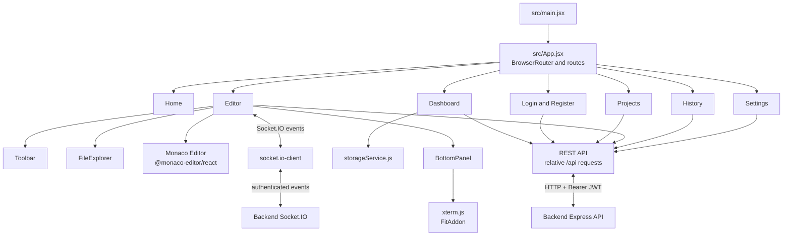

# CloudCode Frontend

React single-page application for the CloudCode browser workspace. It provides registration and login screens, project and file views, a Monaco-based editor, an xterm.js terminal, and dashboard/history views. It communicates with the backend over REST and Socket.IO.

## Technologies and dependencies

| Package | Role |
|---|---|
| React 19, React DOM | UI rendering |
| React Router DOM 7 | Client-side routes |
| Vite 8, `@vitejs/plugin-react` | Development server and production bundling |
| `@monaco-editor/react` | Embedded Monaco code editor |
| `@xterm/xterm`, `@xterm/addon-fit` | Terminal display and fitting |
| `socket.io-client` | Interactive execution stream |
| ESLint and React plugins | Linting |

Exact dependency ranges and lockfile resolutions are in `package.json` and `package-lock.json`. The frontend uses JavaScript/JSX; TypeScript is not configured.

## React and Vite architecture

`src/main.jsx` mounts `App` inside React `StrictMode`. `App.jsx` defines routes with React Router. Page components own their view state and make fetch requests directly; `src/services/storageService.js` contains the storage-usage request helper. `src/Data/` contains display/navigation defaults and language starter code. Styles are colocated with pages, with shared styles in `index.css`.

Routes include `/`, `/login`, `/signup`, `/register`, `/dashboard`, `/projects`, `/projects/new`, `/editor`, `/editor/:projectId`, `/history`, `/profile`, `/settings`, and `/logout`. The `/editor` entry selects the first project or routes to projects if none exist. There is no general catch-all route.

The Vite config proxies `/api` calls to `http://localhost:5000` in development. It does not configure Socket.IO; that URL is explicitly set by the editor.

### Frontend component architecture



`src/Data/` supplies language definitions/starter code and display/navigation data. The diagram shows UI boundaries and communication paths; it does not imply that every settings or toolbar control has a backend implementation.

## Monaco Editor integration

`pages/Editor.jsx` renders `@monaco-editor/react` with language IDs and starter files from `Data/editorData.js`. The editor supports the five backend execution languages: Python, C, C++, Java, and JavaScript. Monaco is configured with automatic layout, a fixed editor font size, smooth scrolling, and a theme selected from the operating system's light/dark preference.

The `LANGS` map in `src/Data/editorData.js` associates each displayed language with its Monaco language ID, default file extension/name, and starter source. Monaco's `value` is the active file's React state; its `onChange` updates that state and marks the file unsaved. The Save control sends the active file's name, content, and language to the backend. Run submits the current editor state without first saving it. The component enables automatic layout, smooth scrolling, and OS dark/light theme selection; it does not apply the Settings page's preview preferences to Monaco.

Editor code is held in React state until the user saves or explicitly runs it. Changing the visible “Auto save” setting in Settings does not enable automatic persistence in the current editor implementation.

## Pages and components

| Area | Responsibility |
|---|---|
| `pages/Home.jsx` | Landing page and illustrative sample editor |
| `pages/Login.jsx`, `pages/Register.jsx` | Login and registration forms |
| `pages/Dashboard.jsx` | Current user, projects, storage and recent execution summaries |
| `pages/Projects.jsx` | Project listing, filtering, sorting, creation |
| `pages/Editor.jsx` | Project/file loading, Monaco editing, save and execute actions |
| `pages/History.jsx` | Execution history filters and run details |
| `pages/Settings.jsx` | Profile display and editor/security settings UI |
| `components/editor/Toolbar.jsx` | Language, save, run/stop, share, account menu |
| `components/editor/FileExplorer.jsx` | File list and file/folder actions |
| `components/editor/BottomPanel.jsx` | Problems, output and xterm terminal tabs |
| `components/auth/PasswordField.jsx` | Password entry with show/hide |
| `components/common/` | Shared icon and logo components |

Some screens expose controls without corresponding backend behavior. Project folders are local-only; profile/password updates are not wired to API callbacks; editor settings are local component state and are not persisted by an API. The landing page's sample Run control shows fabricated sample output after a timer.

## Screenshots

No screenshots are included in this repository. Replace each placeholder with a real, current application capture before publishing screenshots.

| Screen | Placeholder |
|---|---|
| Dashboard | _Dashboard screenshot placeholder — add an actual capture here._ |
| Projects page | _Projects page screenshot placeholder — add an actual capture here._ |
| Code editor | _Code editor screenshot placeholder — add an actual capture here._ |
| Interactive terminal | _Interactive terminal screenshot placeholder — add an actual capture here._ |
| Execution history | _Execution history screenshot placeholder — add an actual capture here._ |

## Authentication integration

The login and registration pages call `/api/auth/login` and `/api/auth/register`. On login, the token and user summary are stored in `localStorage` when “Remember me” is enabled, otherwise in `sessionStorage`. API calls attach `Authorization: Bearer <token>`. The editor passes the token in Socket.IO's handshake `auth` object. Unauthorized responses in implemented flows clear local authentication storage and redirect to `/login`.

The frontend does not define an API for forgot-password, profile updates, or password changes. A “Forgot password?” link is visible on the login page, but `/forgot-password` is not a route.

## Backend API communication

REST requests use relative `/api/...` paths. In development, Vite forwards these requests to the backend at `http://localhost:5000`. The UI currently uses:

- `/api/auth/register`, `/api/auth/login`, `/api/auth/me`
- `/api/projects` and `/api/files/project/:projectId`
- `/api/files`, `/api/files/:fileId`, `/api/files/storage/usage`
- `/api/execute` is an available backend path, but the editor's Run action uses Socket.IO instead.
- `/api/history`

The frontend is not configured with a `VITE_*` environment variable. Production static hosting needs a separately configured API routing strategy. See [backend/README.md](../backend/README.md) for API details.

### Frontend feature to API mapping

These are the REST routes called by the frontend and the separate HTTP execution endpoint available in the backend. Protected requests include `Authorization: Bearer <token>`.

| Frontend feature | Method and endpoint | How the frontend uses it |
|---|---|---|
| Registration | `POST /api/auth/register` | Creates an account from the registration form |
| Login | `POST /api/auth/login` | Authenticates and stores the returned token/user summary |
| Current user | `GET /api/auth/me` | Loads user details in the dashboard, projects, editor, and settings views |
| Project list | `GET /api/projects` | Lists projects for the dashboard/projects views and resolves editor navigation |
| Project creation | `POST /api/projects` | Creates a project from the projects page |
| Project file list | `GET /api/files/project/:projectId` | Loads a project's files in the editor |
| File create | `POST /api/files` | Creates a file, including the initial starter file for an empty project |
| File save/rename/language update | `PUT /api/files/:fileId` | Persists file content and updates its name or language |
| File delete | `DELETE /api/files/:fileId` | Deletes a persisted file |
| Storage usage | `GET /api/files/storage/usage` | Loads the dashboard quota card through `storageService.js` |
| Execution history | `GET /api/history` | Loads dashboard summaries and the history page |
| HTTP execution | `POST /api/execute` | Backend endpoint accepting code, language, optional stdin, required project ID, and optional file ID; the current editor Run action does **not** call it |

Interactive input/output and stop actions use Socket.IO events, not REST endpoints; see [REST versus Socket.IO execution](#rest-versus-socketio-execution).

## Socket.IO integration

The editor connects with `io("http://localhost:5000", { auth: { token }, transports: ["websocket"] })`. It emits:

- `execution:start` with `code`, `language`, `projectId`, `fileId`, `fileName`, and `projectName`.
- `execution:input` with the active `sessionId` and a line of input.
- `execution:stop` with the active `sessionId`.

It listens for `execution:started`, `execution:output`, `execution:exit`, and `execution:error`. The backend accepts only JWT-authenticated socket connections. The URL must be made configurable and the backend's Socket.IO CORS origin updated before using a non-local frontend host.

## REST versus Socket.IO execution

The backend exposes two execution paths; they should not be described as the same frontend request:

| Path | Frontend entry point | Transport and behavior |
|---|---|---|
| HTTP execution | No current editor control calls this route | `POST /api/execute` sends a JSON request over REST and waits for one completion response. It accepts `code`, `language`, `stdin` (optional), `projectId` (required), and `fileId` (optional), then returns the result and execution metadata. The backend applies a 10-second execution timeout. |
| Interactive execution | Run/Stop and the Terminal panel in `pages/Editor.jsx` | Socket.IO authenticates with the JWT in the handshake. The client sends `execution:start`, receives a session ID through `execution:started`, receives output chunks through `execution:output`, sends terminal input through `execution:input`, and stops the run through `execution:stop`. Completion or runtime errors arrive through `execution:exit` or `execution:error`. The interactive backend service has its own five-minute timeout. |

Both server paths use Docker, but the current editor's Run button uses the interactive Socket.IO service. It does not call `POST /api/execute`. The home-page sample editor is a separate timer-driven illustration and uses neither execution path.

## Project and file management

Projects are loaded and created through `/api/projects`. Selecting a project loads its files using `/api/files/project/:projectId`. The editor creates a starter file for an empty project, saves code through `PUT /api/files/:fileId`, and supports file create/rename/delete through the file API.

Folders are generated only in the current React state, have no persisted backend representation, and are lost on reload. The application remembers the last-opened file ID per project in `localStorage`; source text is persisted only after saving.

## Terminal and output display

`components/editor/BottomPanel.jsx` creates one `@xterm/xterm` terminal instance for the component lifetime and loads `@xterm/addon-fit` to size it to the visible panel. A `ResizeObserver` and tab visibility changes trigger fitting. The component appends new output as React state changes and resets/replays it if the displayed output no longer extends the previous text.

Terminal keystrokes are handled in the component: ordinary input is buffered locally, Enter sends the line through `onSendInput`, backspace edits the local buffer, and Ctrl+C invokes the stop callback. In the editor, those callbacks emit `execution:input` (with the active session ID and a newline) and `execution:stop` over Socket.IO. Live output is also displayed in a plain output panel. “Problems” is populated from execution errors, not from a language server or static analyzer. ANSI control sequences are stripped before the plain-text output is updated.

The home-page demo is separate from this actual terminal and does not execute programs.

## Environment variables

No frontend environment variables are read by the current source. Development API proxy and Socket.IO addresses are hard-coded to localhost. Do not put backend secrets in frontend variables; Vite variables are delivered to the browser.

If you want to check in `frontend/.env.example`, the safe current template is comment-only:

```dotenv
# No frontend environment variables are currently read by this application.
```

## Production configuration

**Production API and Socket.IO addresses are not configurable in the current frontend.** Before deploying to a non-local host, replace both localhost assumptions and configure the backend origins to match:

- The relative REST paths such as `/api/projects` work locally because `vite.config.js` proxies `/api` to `http://localhost:5000`. Vite's `server.proxy` is a development-server feature; it is not included in the static production build.
- The Socket.IO client in `pages/Editor.jsx` explicitly connects to `http://localhost:5000`. It must be changed to a production-reachable URL or to a same-origin Socket.IO endpoint behind a reverse proxy.
- The backend Socket.IO server currently allows only `http://localhost:5173`. Configure its allowed origin for the actual frontend origin. Also replace the backend's permissive REST CORS configuration with an explicit production policy.
- Serve production traffic over HTTPS and use the corresponding secure WebSocket transport (`wss`) through the selected host/proxy. Route both `/api` requests and Socket.IO upgrade traffic to the backend.

A same-origin reverse proxy can preserve the frontend's relative `/api` paths, but the Socket.IO URL still needs to target the proxied backend origin/path rather than the hard-coded localhost address. Alternatively, introduce frontend runtime/build configuration for the API base URL and Socket.IO URL, and update backend CORS settings accordingly. Names such as `VITE_API_BASE_URL` or `VITE_SOCKET_URL` would be **new configuration conventions**, not variables currently read by this project. Any `VITE_*` values are exposed in the browser bundle and must never contain secrets.

No production host, proxy configuration, CORS allowlist, environment-based URL selection, or completed deployment is present in this repository. Treat these steps as requirements for future deployment, not as already implemented setup.

No Oracle Cloud-specific deployment plan or configuration is present in this repository. The production guidance above is generic, not an OCI design, and no Oracle Cloud deployment has been verified. Add an approved Oracle Cloud topology only after its services and network design are supplied.

## Installation

Requires Node.js `^20.19.0` or `>=22.12.0` and npm, matching the locked Vite version. From the repository root:

```sh
cd frontend
npm ci
```

The backend must be installed and running separately for API-backed pages and execution.

## Development server

```sh
npm run dev
```

Vite normally serves the application at `http://localhost:5173`. The server proxies REST `/api` requests to `http://localhost:5000`.

## Production build and preview

Create the static production bundle:

```sh
npm run build
```

Vite writes the output to `frontend/dist`. To preview that bundle locally:

```sh
npm run preview
```

`preview` is a local preview command, not production hosting or deployment configuration. Production needs routing for REST and Socket.IO, TLS, allowed origins, and a configurable backend address.

## Linting

```sh
npm run lint
```

No frontend test script is defined in `package.json`.

## Troubleshooting

- **API requests fail:** Start the backend, check its MongoDB connection, and ensure it listens on port `5000` or update the Vite proxy. The development proxy only handles REST paths beginning `/api`.
- **Socket connection errors:** The editor explicitly connects to `http://localhost:5000`; the backend Socket.IO CORS configuration currently allows `http://localhost:5173`. Both sides must be configured for any other origin.
- **Database transaction errors:** File mutations use MongoDB transactions; use a transaction-capable MongoDB deployment, such as an appropriately configured Atlas cluster.
- **Docker execution errors:** Ensure the backend can access Docker Engine and that the runtime images described in the root README are available.
- **Linux build cannot resolve imports:** Some import casing does not match on-disk names (for example `data` versus `Data`, and `Home.css` versus `home.css`). Windows filesystems may hide this; correct the case consistently before building on a case-sensitive system.
- **Forgot-password or Settings actions do not complete:** No matching backend route/callback is connected in this codebase.
